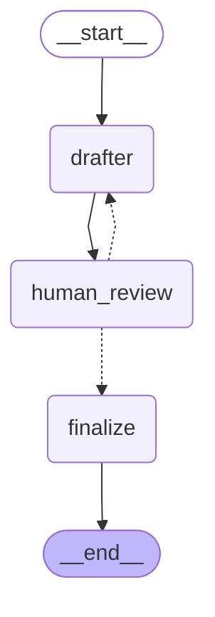

## Customer-Support-Agents

Customer-support agents that combine LangGraph workflow automation with human-in-the-loop review. They answer general FAQs, handle order inquiries, and automate return/ refund requests, escalating to a human when a request is outside the agent's confidence or policy.

### Customer-support workflow

The diagram below is the compiled LangGraph for the customer-support flow. Each API call (`/api/support/...`) enters at `__start__` and a router sends it to one branch. Dotted arrows are conditional edges, and their labels are the router's decisions.

- **General FAQ**: `general_faq_eval_node` -> fuzzy match -> LLM match, escalating when no match is confident enough.
- **Order inquiry**: `retrieve_target_order_node` -> `detect_order_revisit_node` -> a static first reply for a new inquiry, or `order_continue_chat_node` for a revisit and for every later turn.
- **Exchange/ return and refund**: `exchange_return_reason_recommendation_node` -> `initial_return_refund_decision_node` -> `return_refund_process_node`, with `return_refund_chat_node` for questions along the way.
- `summarize_node` condenses finished conversations into long-term memory before the run ends.

The diagram is generated: run `backend/workflow/draw_workflow_images.ipynb` and paste the output of `draw_mermaid()` here.

```mermaid
---
config:
  flowchart:
    curve: linear
---
graph TD;
	__start__([<p>__start__</p>]):::first
	summarize_node(summarize_node)
	general_faq_eval_node(general_faq_eval_node)
	general_faq_fuzz_match_node(general_faq_fuzz_match_node)
	general_faq_llm_match_node(general_faq_llm_match_node)
	order_continue_chat_node(order_continue_chat_node)
	retrieve_target_order_node(retrieve_target_order_node)
	detect_order_revisit_node(detect_order_revisit_node)
	order_init_static_response_node(order_init_static_response_node)
	exchange_return_reason_recommendation_node(exchange_return_reason_recommendation_node)
	initial_return_refund_decision_node(initial_return_refund_decision_node)
	return_refund_process_node(return_refund_process_node)
	return_refund_chat_node(return_refund_chat_node)
	__end__([<p>__end__</p>]):::last
	__start__ -. &nbsp;return_refund_done_or_unknown&nbsp; .-> __end__;
	__start__ -. &nbsp;exchange_or_return&nbsp; .-> exchange_return_reason_recommendation_node;
	__start__ -. &nbsp;general_faq&nbsp; .-> general_faq_eval_node;
	__start__ -. &nbsp;return_refund_init&nbsp; .-> initial_return_refund_decision_node;
	__start__ -. &nbsp;order_init_done&nbsp; .-> order_continue_chat_node;
	__start__ -. &nbsp;order_init&nbsp; .-> retrieve_target_order_node;
	__start__ -. &nbsp;return_refund_chat&nbsp; .-> return_refund_chat_node;
	__start__ -. &nbsp;return_refund_process&nbsp; .-> return_refund_process_node;
	__start__ -.-> summarize_node;
	detect_order_revisit_node -.-> order_continue_chat_node;
	detect_order_revisit_node -.-> order_init_static_response_node;
	exchange_return_reason_recommendation_node --> summarize_node;
	general_faq_eval_node -.-> general_faq_fuzz_match_node;
	general_faq_eval_node -.-> general_faq_llm_match_node;
	general_faq_eval_node -.-> summarize_node;
	general_faq_fuzz_match_node -.-> general_faq_llm_match_node;
	general_faq_fuzz_match_node -.-> summarize_node;
	general_faq_llm_match_node --> summarize_node;
	initial_return_refund_decision_node --> summarize_node;
	order_continue_chat_node -.-> __end__;
	order_continue_chat_node -.-> summarize_node;
	order_init_static_response_node --> summarize_node;
	retrieve_target_order_node -.-> detect_order_revisit_node;
	retrieve_target_order_node -.-> summarize_node;
	return_refund_chat_node -.-> __end__;
	return_refund_chat_node -.-> summarize_node;
	return_refund_process_node --> summarize_node;
	summarize_node --> __end__;
	classDef default fill:#f2f0ff,line-height:1.2
	classDef first fill-opacity:0
	classDef last fill:#bfb6fc
```

### Approval workflow (CSR draft letters)

A customer-support representative (CSR) asks the AI to draft a customized customer letter, and a human approves it before it is "sent". This is the LangGraph `interrupt` / `Command(resume=...)` pattern: `human_review` pauses the thread until the CSR responds.

- `drafter` writes the draft with the LLM (using the CSR's feedback on a redraft).
- `human_review` interrupts with the draft and three actions: **approve** (send as is), **edit** (send the CSR's own revised text), or **reject** with feedback.
- On reject, the graph loops back to `drafter` for a redraft, up to 3 revisions; after that it finalizes with the feedback unresolved.
- `finalize` records the final letter and the status (`sent` or `sent_with_unresolved_feedback`).

